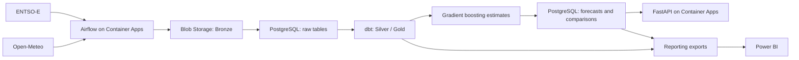

# WeatherEnergy

An hourly weather and electricity analytics pipeline deployed on **Microsoft Azure**.
WeatherEnergy combines ENTSO-E electricity data with Open-Meteo weather observations
for France, Germany–Luxembourg and Spain. It produces analytical tables and gradient
boosting estimates of electricity demand, solar generation and wind generation.

**Stack:** Python · Apache Airflow · dbt · PostgreSQL · Azure Container Apps ·
Azure Blob Storage · Terraform · FastAPI · Power BI

## Architecture



The deployed application region is **Switzerland North**. Airflow scheduler,
webserver and FastAPI run in a private Container Apps environment. Container Apps
Jobs handle bootstrap and monitoring. Key Vault stores secrets; managed identities
provide scoped service access. Terraform manages the infrastructure.

Power BI currently consumes exported datasets. A direct, private Power BI connection
is not provisioned by this repository. See [architecture](docs/architecture.md) for
network boundaries and the difference between the current deployment and the target diagram.

## Pipeline and reliability

1. Fetch hourly data for each zone, rereading seven days to capture late publications.
2. Store raw objects in Blob Storage and load their versions transactionally into PostgreSQL.
3. Check source freshness, build dbt models, and run 33 data-quality tests.
4. Generate demand, solar and wind estimates, then compare predictions with observations.
5. Serve results through an authenticated API and reporting datasets.

ETags, load receipts and PostgreSQL transactions make retries safe. An advisory lock
protects concurrent loads. Airflow limits the DAG to one active run. Missing generation
observations remain null rather than being silently converted to zero.

## Forecast scope

The model is a baseline with a target one hour after the latest usable observation.
Delayed source data can put that target in the past at prediction time. Execution
success and low comparison errors do not establish prospective forecasting skill.
A time-based backtest, issue-time availability checks and stronger weather coverage
are required before operational forecasting use.

## Repository

| Directory | Purpose |
| --- | --- |
| `airflow/` | Hourly DAG and scheduler/webserver image |
| `ingestion/` | API clients, Blob storage, transactional loader and quality checks |
| `dbt/` | Staging, analytical models and data tests |
| `forecasting/` | Training and prediction baseline |
| `api/` | Read-only API and container image |
| `platform_common/` | Shared database connections and migrations |
| `scripts/` | Bootstrap, monitoring, container entrypoint and deployment preparation |
| `infra/azure/` | Cloud infrastructure and mocked Terraform tests |
| `.github/ci/`, `tests/` | Isolated regression tests; no production deployment |
| `docs/` | Architecture, operations and project limitations |

## Deploy

Follow the [Azure deployment guide](infra/azure/README.md). It covers remote state,
foundation, image publication, bootstrap and application deployment. Azure resources
incur charges. Region support does not guarantee quota or compute availability.

For an existing deployment, keep its current backend, names, credentials and stage.
Do not initialize a new state or apply example values over an existing environment.
Private application URLs require a network path to the VNet; the Azure portal does
not provide a browser-network bypass.

## Delivery

The [CD workflow](docs/continuous-delivery.md) publishes digest-pinned images to ACR
and updates existing Container Apps after successful CI and an operator-confirmed
Airflow maintenance window. One-time Azure OIDC and GitHub environment configuration
is required before activation.

## Validate

GitHub Actions runs image builds, integration tests and mocked Terraform plans.
The PostgreSQL and Azurite containers below are **test fixtures**, not a local
production deployment. They require Docker and do not require Azure credentials.

```bash
docker build -t weather-energy-airflow:audit-test -f airflow/Dockerfile .
docker build -t weather-energy-api:audit-test -f api/Dockerfile .
docker compose --env-file .github/ci/ci.env -p weather-energy-ci -f .github/ci/compose.yml run --rm tests
docker compose --env-file .github/ci/ci.env -p weather-energy-ci -f .github/ci/compose.yml run --rm --no-deps api-tests
docker compose --env-file .github/ci/ci.env -p weather-energy-ci -f .github/ci/compose.yml down --volumes
```

See [contributing](CONTRIBUTING.md), [security](SECURITY.md) and
[operations](docs/operations.md). The latest [validation record](docs/validation.md)
documents checks actually performed. Airflow 2.9.3 is retained for deployed-image
compatibility; upgrading and testing it is a separate prerequisite for production hardening.
